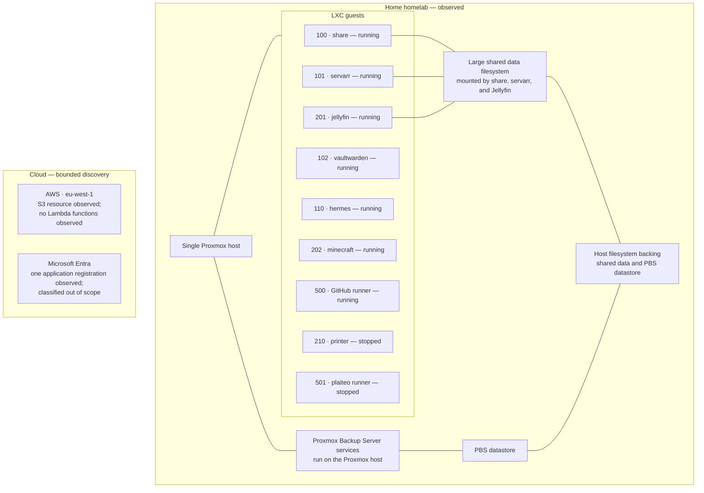
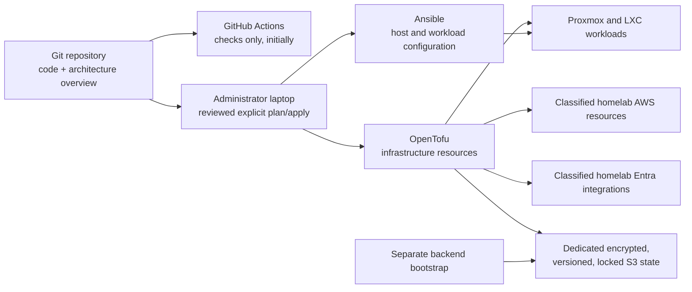
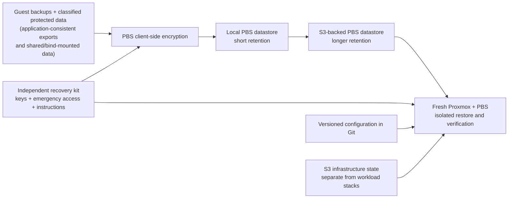

# Homelab architecture

This document is the shareable overview of the homelab's observed state and intended direction. It is not a deployment specification: detailed configuration belongs in code, domain language in `GLOSSARY.md`, and durable architectural choices in `docs/adr/`.

## How to read this document

- **Observed** means confirmed by bounded read-only discovery on 2026-11-25 or on the later date specified below. Mutable facts must be refreshed during the next inventory.
- **Intended** means an agreed design direction, not something already deployed or proven.
- **Unknown** means the available discovery did not establish the fact. Do not infer a dependency or capability from proximity in a diagram.
- Workload names are shown as useful high-level labels. Hostnames, addresses, storage identifiers, cloud account/resource identifiers, DNS records, and secret values are intentionally omitted to keep this overview safe to share.

## Observed system

The diagram groups related components; it does not assert network connectivity or service-to-service dependencies beyond the shared filesystem mounts and storage relationships shown.

### Observed inventory

| Area | Observed state | Not established |
|---|---|---|
| Proxmox | One host; nine LXC guests: seven running and two stopped, as shown above. | Guest configuration ownership, external dependencies, and whether stopped guests remain in scope. |
| Guest services | Share provides file-sharing services; servarr runs Docker-managed media-management services; Vaultwarden, Hermes dashboard, Jellyfin, Minecraft controller, and GitHub runner services were observed. | Full service contracts, data consistency requirements, exposure, and recovery priority for each workload. |
| Storage | Share, servarr, and Jellyfin each have a Proxmox-managed mount of the same shared volume; none is marked for backup. Its backing file and the PBS datastore reside on the same host filesystem on a single disk; that filesystem reports approximately 3.5 TiB used, including the datastore. Guest root filesystems reside on a ZFS mirror. | Protected-data size and change rate, exact shared-data classification, and whether other storage or off-site copies exist. The filesystem usage is not the size of protected data. |
| Local backups | PBS 4.2.14-1 services run on the Proxmox host. A daily 01:00 snapshot job targets PBS and currently excludes runner guests 500 and 501. Its ten most recent runs report success, but only the latest included Vaultwarden; the preceding nine included the runners instead. The latest job completed backups of the other seven guests, but explicitly excluded the shared volume from all three guests that mount it. The PBS prune job is configured for keep-last 3, keep-daily 3, and keep-weekly 1; no PBS verification job is configured. A retained container-restore task reported success on 2026-06-29. No PVE-managed client encryption key file was found in the default location for this storage. | The observed datastore's root namespace lists only one Vaultwarden snapshot dated in 2026, following three dated in 2025. Snapshot entries and job success do not prove recoverability or rule out other copies. The historical restore's source and application usability are unverified. Application consistency, snapshot encryption, other key arrangements, notifications, and recent successful restore evidence remain unknown. The excluded shared volume is not covered by this guest-backup job. Same-host PBS on the same disk does not establish protection from host loss. |
| Network access | Tailscale was observed on the host and some guests. All seven running guests had at least one TCP listener bound to a wildcard address. On 2026-11-26 the Proxmox firewall reported `disabled/running`; host IPv4 and IPv6 forwarding were disabled, and the host `iptables` NAT table showed no DNAT target. Four guests had a Tailscale interface and listed its DNS resolver alongside another private or loopback resolver. Tailscale Serve status on the host, Vaultwarden, and Hermes was `tailnet only`; no Serve configuration was reported on servarr and Jellyfin. The Tailscale CLI was unavailable in share, Minecraft, and the runner guest. The owner reports that the Proxmox host uses a UniFi gateway and that access is mainly through Tailscale, with no workload intentionally public. | Wildcard listeners and the Proxmox firewall status alone do not establish internet exposure or the state of other firewalls. The Tailscale Serve checks do not prove the absence of public DNS or router-level forwarding. The owner kept UniFi management out of scope, so gateway forwarding and UPnP settings were not inspected. Full membership, access paths, DNS resolution, independently verified exposure, and which services depend on external network access remain unknown. |
| AWS | Bounded read-only discovery in `eu-west-1` found one S3 bucket and, after the owner removed a previously observed Lambda, no Lambda functions. The owner classified the existing bucket and former Lambda as out of scope and identified no additional relevant regions or services on 2026-11-26. On that date, an unfiltered Resource Explorer view returned 54 indexed resources in `eu-west-1`, across multiple service types, including networking and IoT; the regional index was an active aggregator. | The additional indexed resources are not classified as homelab-owned. The search reported a complete result for that query, not complete coverage of every AWS resource type or account recovery dependency. Sixteen of the account's 17 enabled regions had Resource Explorer indexes; the unindexed region was not identified as relevant by the owner. |
| Entra | One application registration and service principals were observed in the requested tenant. The owner classified that registration as out of scope and identified no other particular homelab-owned enterprise applications or assignments on 2026-11-26. An earlier listing was from a different tenant and is not evidence about the requested tenant. | Whether other enterprise applications or assignments are homelab-owned or required for recovery; no tenant-wide classification is implied. |

These are inventory observations, not proof that backups are restorable or that recovery objectives are currently met. No credentials, environment values, detailed guest configuration, or application data are documented here.

### Guest ownership and recovery priority

The owner-admin reports owning all nine guests. The following root-filesystem
usage and running states were observed on 2026-11-26; sizes include software
and replaceable data, not just protected data. The local backup column describes
the latest observed guest job, not proof of a usable restore. Workload priority
does not determine whether its data is protected.

| Guest | Observed workload and root usage | Recovery priority | Latest local guest-job coverage |
|---|---|---|---|
| Share | Running file sharing; 2.86 GiB root plus the shared volume. | Best-effort: the owner says the guest image can be rebuilt and its selected data restored after essential workloads. | Root included; shared volume excluded. |
| Servarr | Running Docker-managed media services; 5.91 GiB root plus the shared volume. | Best-effort media workload. | Root included; shared volume excluded. |
| Vaultwarden | Running password vault; 0.13 GiB root. | Essential, as named by the owner. | Root included; the preceding nine observed jobs did not include it. |
| Hermes | Running dashboard; 9.21 GiB root. | Best-effort, as named by the owner; its irreplaceable state remains protected. | Root included. |
| Jellyfin | Running media service; 2.73 GiB root plus the shared volume. | Best-effort media workload. | Root included; shared volume excluded. |
| Minecraft | Running game controller and Bedrock server; 2.16 GiB root. | Best-effort game workload; its worlds and state are protected. | Root included. |
| GitHub runner | Running runner; 1.67 GiB root. | Best-effort. | Excluded. |
| Printer | Stopped; its actual service and root usage were not inspected while stopped. | Best-effort. | Guest included in the latest job; application usability is unknown. |
| Plaiteo runner | Stopped; its actual service and root usage were not inspected while stopped. | Best-effort. | Excluded. |

On 2026-11-26 the owner chose to restore Share's selected data after essential
workloads. The parent issue describes workloads providing irreplaceable files
as essential; this distinction should be reconciled with that issue before
treating it as a change to the parent recovery objectives. It does not change
the data-loss objective or the requirement to protect that data.

### Protected-data inventory in progress

| Dataset | Current evidence and classification | Remaining gaps |
|---|---|---|
| Home videos | The owner confirmed the entire identified directory on the shared volume should be protected. A read-only measurement on 2026-11-25 found approximately 52.0 GiB allocated in that directory. The guest-backup job excludes the volume. | Measured change rate, consistency, and exact off-site sizing remain unknown. |
| Future photos | The owner identified a planned location on the shared volume; it did not exist on 2026-11-25. Photos are protected data when present. | Expected size, growth, and coverage when the location is created. |
| Vaultwarden | Credentials are an essential recovery concern. The owner reports configuration is on the guest disk. The working directory containing its standard database used approximately 116 KiB on 2026-11-25; the default attachment and Send directories beside it were absent. On 2026-11-26 the running process had that database and its WAL and shared-memory files open. The latest guest-backup job included its root filesystem, but the preceding nine jobs did not include this guest. No additional Proxmox-managed mount or NFS/CIFS/SSHFS mount was observed in this guest. | Verify any custom database, attachment, or Send locations, consistency requirements, and recovery procedure; open files and a guest snapshot alone do not establish complete or application-consistent coverage or rule out other external storage. |
| Minecraft | The owner confirmed all worlds and game state should be protected, even though the workload is best-effort. The guest root filesystem is included in the guest-backup job. Four candidate world directories, using approximately 11.9 MiB in total, were found under the controller installation on 2026-11-25; the entire installation used approximately 538 MiB. No additional Proxmox-managed mount or NFS/CIFS/SSHFS mount was observed in this guest. On 2026-11-26 a Bedrock server was running, with one candidate world directory under its working directory and three open file descriptors beneath that world; no process named `java` was observed. | Verify all world and configuration locations, consistency requirements, and recovery procedure; marker directories may include copies, and the measurements may not cover other external locations. |
| Servarr | The owner wants configuration and library metadata protected. The guest root filesystem is included in the guest-backup job, while the shared volume is excluded. Inspected Docker configuration bind mounts use a directory on the guest root filesystem, which used approximately 363 MiB on 2026-11-25. On 2026-11-26 database-like files and SQLite WAL/shared-memory sidecars were present for several media-management services. | Verify all application data locations, consistency requirements, and which metadata resides on the shared volume; the directory measurement may include non-protected data, and sidecar presence alone does not establish a consistent backup. |
| Jellyfin and related statistics | The owner identified catalog, user, and viewing-statistics data as protected. The running Jellyfin service uses a working directory on its guest root filesystem, which used approximately 1.5 GiB on 2026-11-25. On 2026-11-26 it had a database-like file and its WAL and shared-memory files open in that directory; a separate standard configuration directory was also present. A separate Jellystat service and PostgreSQL container were observed in servarr, with a database bind directory on its guest root filesystem. On 2026-11-26 the running database container's `postgres` and `pg_dump` utilities both reported version 15.2. Both root filesystems are included in the guest-backup job. | Verify which databases contain the required data, their full locations, consistency requirements, and recovery procedure; directory sizes do not establish protected-data size and utility availability does not prove a usable dump. |
| Hermes dashboard | The owner identified irreplaceable state or recovery-critical configuration. The running dashboard uses a working directory on its guest root filesystem, which used approximately 8.0 GiB on 2026-11-25. Two conventional cache directories under it used approximately 2.16 GiB on 2026-11-26. The root filesystem is included in the guest-backup job. | Identify the protected data and its actual location, size, consistency requirements, and recovery procedure; the working-directory measurement includes other data. |

The owner reports no existing off-site homelab copies or backup plan, despite the configured local job. Laptop and other personal-device backups are out of scope and handled separately; that does not establish coverage for data stored only on the homelab. On 2026-11-26 the owner selected only the home-video and future-photo directories for protection on the attached shared data volume. Downloaded films, TV, and music can be replaced; the owner also excludes temporary downloads. These exclusions do not apply to home videos or future photos or to protected application data on guest roots. Verify whether any required application metadata is on the shared volume before finalizing exclusions. The owner is unsure whether other protected datasets exist.

On 2026-11-26 the home-video directory used 54,529,612 KiB (52.003 GiB; 55.84 decimal GB); the photo directory was still absent. A read-only refresh on the same date found approximately 100 KiB in Vaultwarden's standard data directory, 364.8 MiB in servarr's `/app` directory, 1.49 GiB in Jellyfin's data directory plus 1.5 MiB in its standard configuration directory, 36.5 MiB in the Jellystat PostgreSQL data directory, and 7.95 GiB in the Hermes working directory. The Hermes working directory included 2.17 GiB in two conventional cache directories; 24 database-named files totalled 29.7 MB, but their purpose and protected status were not established. A search for Minecraft `level.dat` markers found three candidate directories totalling 8.6 MiB, unlike the four candidate directories totalling 11.9 MiB found by the earlier marker search; this difference requires reconciliation. These directory measurements are not confirmed protected-data totals. The photo directory remains absent.

The owner estimates approximately 2 GB of new or changed protected data per month. The estimate has not been measured. Allocated directory size is not a measure of changed bytes; no historic off-site backup exists from which to measure deduplicated growth. The measurements above are not measurements of all protected data or its change rate; retained-history, request, and restore costs cannot yet be established.

The owner reports using an independent Bitwarden service for access credentials, rather than the Vaultwarden guest, and being able to access and recover it without Entra or the homelab. This has not been tested as part of a recovery exercise. A complete independently held recovery kit has not been established.

The owner reports no irreplaceable state or recovery-critical configuration for the printer and runners. The stopped guests remain untouched.

### Discovery still required

- Public DNS, Tailscale policy, and upstream firewall/forwarding configuration
  have not been independently verified. The owner confirmed the upstream
  gateway is UniFi and chose to keep its management out of scope. Do not infer
  that there is no public ingress from listener bindings or host-side checks.
- The owner classifies Share's selected data as protected but schedules its
  restoration after essential workloads; the rebuildable Share guest is
  best-effort. The parent issue's broad definition of essential workloads
  includes workloads providing irreplaceable files. Preserve this explicit
  dataset/workload distinction when interpreting the 24-hour recovery target.
  Identify the dashboard's actual protected state and confirm all application
  databases, attachments, world files, and shared-volume metadata without
  publishing filenames or contents.
- Measure the complete selected datasets and repeat comparable measurements
  over time; used space alone does not measure changed bytes. Measure actual
  backup churn, retained history, request counts, and restore/exercise costs
  after a scoped backup path exists and before deciding whether the
  EUR 25/month ceiling is feasible. Until then, the cost scenario is conditional.
- Identify independently recoverable keys and access, application-consistent
  backup methods, retention and deletion protection, and an isolated
  fresh-install restore path. The current evidence does not prove either
  24-hour objective.

## Intended management and change flow

This is the agreed target, not a deployed implementation. Use one owner per resource or setting: OpenTofu for infrastructure resources and Ansible for host/workload configuration. Initially, applies are explicit from a laptop; the GitHub runner is not a bootstrap prerequisite. Adopt existing resources only after classification and reviewed plans show no unintended changes. UniFi management, physical-network redesign, tenant-wide identity management, and automatic failover are out of scope.

## Intended recovery boundary

The owner wants short-lived local PBS backups for fast recovery and an incremental PBS copy in S3. After complete host loss, the intended path is to install Proxmox and PBS afresh, reconnect the S3-backed datastore, and restore the selected guests and protected data using independently held keys and access. A PBS snapshot in S3 comprises shared chunks and metadata, not one standalone file.

The local retention target is three days. The owner confirmed the longer off-site target remains 7 daily / 4 weekly / 3 monthly recovery points. Local pruning must not remove the longer off-site history. Exact protected datasets, client encryption, independent deletion protection, costs, and the fresh-install restore remain subject to validation; this path is not yet deployed. Recovery must not depend on the lost Proxmox host, its runner, Vaultwarden, or Entra sign-in.

A disposable test on 2026-11-26 synced two encrypted synthetic snapshots from a local PBS datastore to an S3-backed PBS datastore. Both remained off site after one was deleted locally and could be restored after reconnecting with a new cache. The test resources were removed. This used the existing PBS installation, not a fresh installation, and did not establish production coverage, retention schedules, deletion protection, key recovery, or application usability.

The other initial objectives are essential-workload recovery within 24 hours after replacement hardware and internet are available and no more than 24 hours of data loss. Additional recurring cost is capped at EUR 25/month without approval. These are design objectives, not verified capabilities or a high-availability SLA.

The [off-site recovery assessment](recovery-assessment.md) evaluates candidate mechanisms and a conditional cost scenario; it does not describe a deployed backup path.

## Keeping this overview current

Update this document in the same change whenever workload ownership, topology, dependencies, data locations, access, deployment, or backup/recovery paths change. During inventory and adoption, compare the diagram with the observed environment; distinguish observed state from intended state and leave unverified edges out. Refresh dated facts that may have drifted. Do not add secrets, credentials, private keys, personal data, or sensitive account/resource identifiers.
