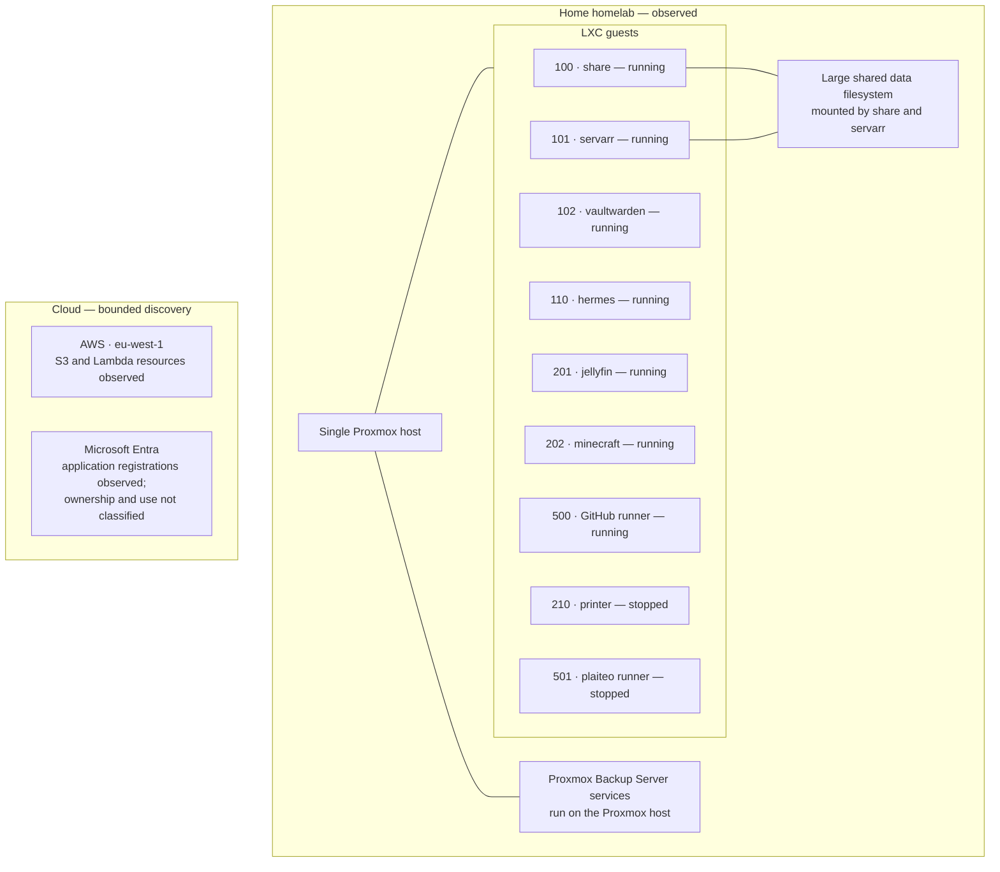
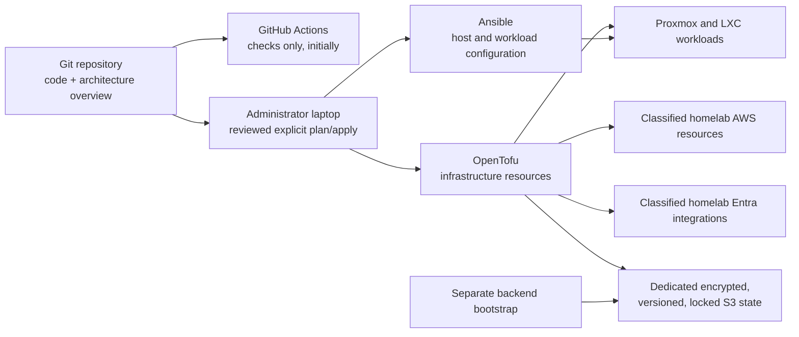
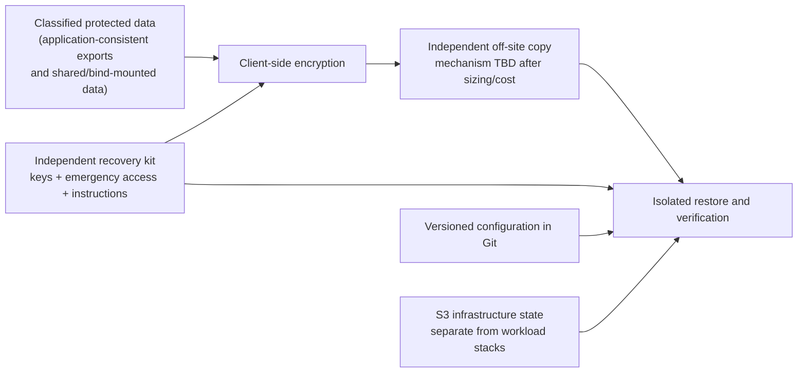

# Homelab architecture

This document is the shareable overview of the homelab's observed state and intended direction. It is not a deployment specification: detailed configuration belongs in code, domain language in `GLOSSARY.md`, and durable architectural choices in `docs/adr/`.

## How to read this document

- **Observed** means confirmed by bounded read-only discovery on 2026-11-25. Mutable facts must be refreshed during the next inventory.
- **Intended** means an agreed design direction, not something already deployed or proven.
- **Unknown** means the available discovery did not establish the fact. Do not infer a dependency or capability from proximity in a diagram.
- Workload names are shown as useful high-level labels. Hostnames, addresses, storage identifiers, cloud account/resource identifiers, DNS records, and secret values are intentionally omitted to keep this overview safe to share.

## Observed system

The diagram groups related components; it does not assert network connectivity or service-to-service dependencies beyond the shared filesystem mounts and the placement of PBS services on the Proxmox host.

### Observed inventory

| Area | Observed state | Not established |
|---|---|---|
| Proxmox | One host; nine LXC guests: seven running and two stopped, as shown above. | Guest configuration ownership, external dependencies, and whether stopped guests remain in scope. |
| Guest services | Share provides file-sharing services; servarr runs Docker-managed media-management services; Vaultwarden, Hermes dashboard, Jellyfin, Minecraft controller, and GitHub runner services were observed. | Full service contracts, data consistency requirements, exposure, and recovery priority for each workload. |
| Storage | A large shared filesystem is mounted by share and servarr; roughly 3.8 TB was reported used across the observed large storage figures. | Protected-data size, exact shared-data contents, physical device mapping for every mount, and which data is replaceable. |
| Local backups | PBS services run on the Proxmox host. A daily 01:00 guest-backup job targets PBS and excludes runner guests 500 and 501. | Datastore backing device/location, retention, job success history, shared/bind-mount coverage, encryption, key independence, and successful restore evidence. Same-host PBS does not establish protection from host loss. |
| Network access | Tailscale was observed on the host and some guests. | Full membership, access paths, DNS, firewall/public exposure, and which services depend on external network access. |
| AWS | Bounded read-only discovery in `eu-west-1` found S3 and Lambda resources. | Complete service/region inventory and which resources are homelab-owned. |
| Entra | Application registrations were observed. | Which registrations, enterprise applications, or assignments are homelab-owned or required for recovery. |

These are inventory observations, not proof that backups are restorable or that recovery objectives are currently met. No credentials, environment values, guest configuration, or application data are documented here.

## Intended management and change flow

This is the agreed target, not a deployed implementation. Use one owner per resource or setting: OpenTofu for infrastructure resources and Ansible for host/workload configuration. Initially, applies are explicit from a laptop; the GitHub runner is not a bootstrap prerequisite. Adopt existing resources only after classification and reviewed plans show no unintended changes. UniFi management, physical-network redesign, tenant-wide identity management, and automatic failover are out of scope.

## Intended recovery boundary

Keep local PBS for convenient restores and add selective off-site protection for data that is difficult or unacceptable to recreate. The off-site mechanism and exact protected datasets remain subject to inventory, cost, and restore validation. Recovery must not depend on the Proxmox host, its runner, Vaultwarden, or Entra sign-in.

Agreed initial objectives are essential-workload recovery within 24 hours after replacement hardware and internet are available, no more than 24 hours of data loss, and 7 daily / 4 weekly / 3 monthly recovery points. Additional recurring cost is capped at EUR 25/month without approval. These are design objectives, not verified capabilities or a high-availability SLA.

## Keeping this overview current

Update this document in the same change whenever workload ownership, topology, dependencies, data locations, access, deployment, or backup/recovery paths change. During inventory and adoption, compare the diagram with the observed environment; distinguish observed state from intended state and leave unverified edges out. Refresh dated facts that may have drifted. Do not add secrets, credentials, private keys, personal data, or sensitive account/resource identifiers.
