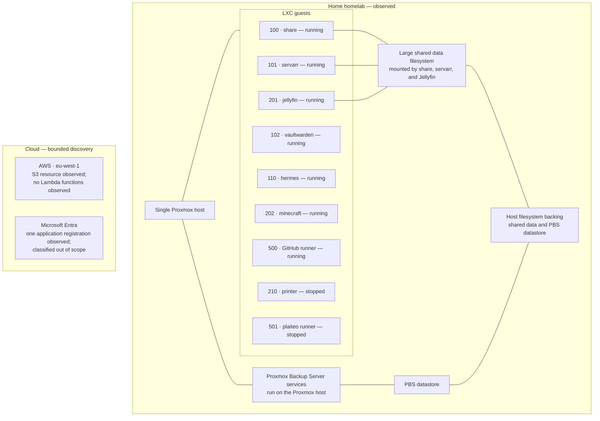
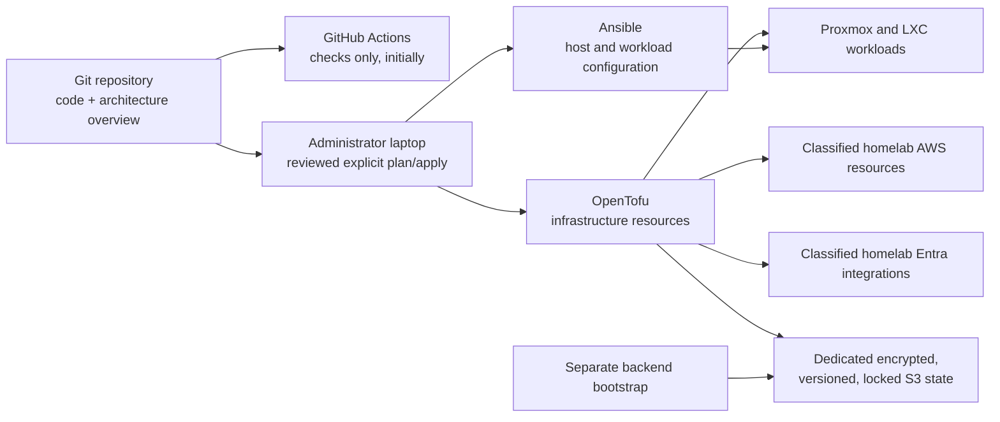
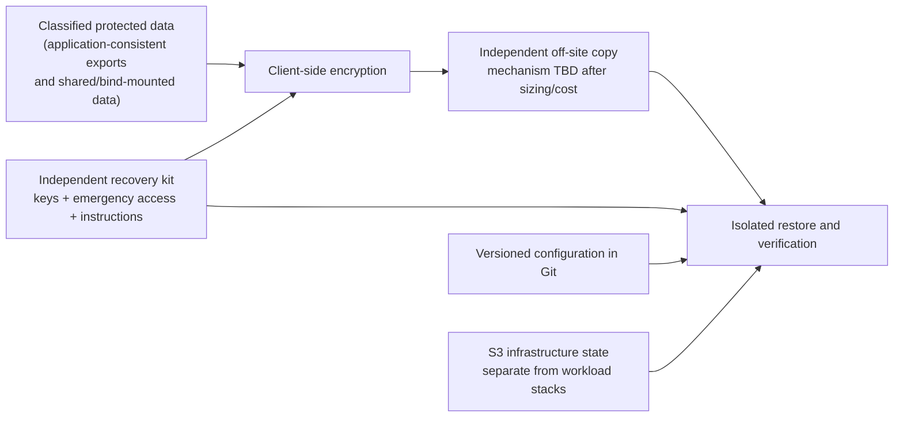

# Homelab architecture

This document is the shareable overview of the homelab's observed state and intended direction. It is not a deployment specification: detailed configuration belongs in code, domain language in `GLOSSARY.md`, and durable architectural choices in `docs/adr/`.

## How to read this document

- **Observed** means confirmed by bounded read-only discovery on 2026-11-25. Mutable facts must be refreshed during the next inventory.
- **Intended** means an agreed design direction, not something already deployed or proven.
- **Unknown** means the available discovery did not establish the fact. Do not infer a dependency or capability from proximity in a diagram.
- Workload names are shown as useful high-level labels. Hostnames, addresses, storage identifiers, cloud account/resource identifiers, DNS records, and secret values are intentionally omitted to keep this overview safe to share.

## Observed system

The diagram groups related components; it does not assert network connectivity or service-to-service dependencies beyond the shared filesystem mounts and storage relationships shown.

### Observed inventory

| Area | Observed state | Not established |
|---|---|---|
| Proxmox | One host; nine LXC guests: seven running and two stopped, as shown above. | Guest configuration ownership, external dependencies, and whether stopped guests remain in scope. |
| Guest services | Share provides file-sharing services; servarr runs Docker-managed media-management services; Vaultwarden, Hermes dashboard, Jellyfin, Minecraft controller, and GitHub runner services were observed. | Full service contracts, data consistency requirements, exposure, and recovery priority for each workload. |
| Storage | Share, servarr, and Jellyfin mount the same shared volume. Its backing file and the PBS datastore reside on the same host filesystem on a single disk; that filesystem reports approximately 3.5 TiB used, including the datastore. Guest root filesystems reside on ZFS storage. | Protected-data size and change rate, exact shared-data classification, and whether other storage or off-site copies exist. The filesystem usage is not the size of protected data. |
| Local backups | PBS services run on the Proxmox host. A daily 01:00 snapshot job targets PBS, excludes runner guests 500 and 501, and reports success for its ten most recent runs. The latest job completed backups of the other seven guests, but explicitly excluded the shared volume from all three guests that mount it. The PBS prune job is configured for keep-last 3, keep-daily 3, and keep-weekly 1. | Application consistency, actual retained recovery points, encryption, key independence, notifications, and successful restore evidence. The excluded shared volume is not covered by this guest-backup job; other backup coverage is unknown. Same-host PBS on the same disk does not establish protection from host loss. |
| Network access | Tailscale was observed on the host and some guests. The owner reports that access is mainly through Tailscale and that no workload is intentionally public. | Full membership, access paths, DNS, firewall rules, independently verified exposure, and which services depend on external network access. |
| AWS | Bounded read-only discovery in `eu-west-1` found one S3 bucket and, after the owner removed a previously observed Lambda, no Lambda functions. The owner classified the existing bucket and former Lambda as out of scope. | Other service inventory, account recovery dependencies, and any homelab-owned resources not yet identified. The owner identified only this region and these services for initial discovery. |
| Entra | One application registration and service principals were observed in the requested tenant. The owner classified that registration as out of scope. An earlier listing was from a different tenant and is not evidence about the requested tenant. | Whether other enterprise applications or assignments are homelab-owned or required for recovery. |

These are inventory observations, not proof that backups are restorable or that recovery objectives are currently met. No credentials, environment values, detailed guest configuration, or application data are documented here.

### Protected-data inventory in progress

| Dataset | Current evidence and classification | Remaining gaps |
|---|---|---|
| Home videos | The owner identified a directory on the shared volume containing protected home videos. A read-only measurement on 2026-11-25 found approximately 52.0 GiB allocated in that directory. The guest-backup job excludes the volume. | Contents are not individually classified; change rate, consistency, and exact off-site sizing remain unknown. |
| Future photos | The owner identified a planned location on the shared volume; it did not exist on 2026-11-25. Photos are protected data when present. | Expected size, growth, and coverage when the location is created. |
| Vaultwarden | Credentials are an essential recovery concern. The owner reports configuration is on the guest disk. A standard database file exists in the process working directory, which used approximately 116 KiB on 2026-11-25; the guest root filesystem is included in the guest-backup job. | Verify the active database and any attachment locations, consistency requirements, and recovery procedure; file presence alone does not establish data coverage. |
| Minecraft | The owner confirmed all worlds and game state should be protected, even though the workload is best-effort. The guest root filesystem is included in the guest-backup job; world marker files were found under the controller installation, which used approximately 538 MiB on 2026-11-25. | Verify all world and configuration locations, consistency requirements, and recovery procedure; the installation measurement may include other data and may not cover external locations. |
| Servarr | The owner wants configuration and library metadata protected. The guest root filesystem is included in the guest-backup job, while the shared volume is excluded. Inspected Docker configuration bind mounts use a directory on the guest root filesystem, which used approximately 363 MiB on 2026-11-25. | Verify all application data locations, consistency requirements, and which metadata resides on the shared volume; the directory measurement may include non-protected data. |
| Jellyfin and related statistics | The owner identified catalog, user, and viewing-statistics data as protected. The running Jellyfin service uses a working directory on its guest root filesystem, which used approximately 1.5 GiB on 2026-11-25. A separate Jellystat service and PostgreSQL container were also observed in servarr, with a database bind directory on its guest root filesystem. Both root filesystems are included in the guest-backup job. | Verify which databases contain the required data, their full locations, consistency requirements, and recovery procedure; directory sizes do not establish protected-data size. |
| Hermes dashboard | The owner identified irreplaceable state or recovery-critical configuration. The running dashboard uses a working directory on its guest root filesystem, which used approximately 8.0 GiB on 2026-11-25. The root filesystem is included in the guest-backup job. | Identify the protected data and its actual location, size, consistency requirements, and recovery procedure; the working-directory measurement includes other data. |

The owner reports no existing off-site copies or backup plan, despite the configured local job. Downloaded films, TV, and music can be replaced; the owner also excludes temporary downloads. These exclusions do not apply to home videos or future photos. No broader exclusion is implied. The owner estimates approximately 2 GB of new or changed protected data per month. The measurements above are not measurements of all protected data or its change rate; retained-history, request, and restore costs cannot yet be established.

The owner reports using an independent Bitwarden service for access credentials, rather than the Vaultwarden guest, and being able to access and recover it without Entra or the homelab. This has not been tested as part of a recovery exercise. A complete independently held recovery kit has not been established.

The owner reports no irreplaceable state or recovery-critical configuration for the printer and runners. The stopped guests remain untouched.

## Intended management and change flow

This is the agreed target, not a deployed implementation. Use one owner per resource or setting: OpenTofu for infrastructure resources and Ansible for host/workload configuration. Initially, applies are explicit from a laptop; the GitHub runner is not a bootstrap prerequisite. Adopt existing resources only after classification and reviewed plans show no unintended changes. UniFi management, physical-network redesign, tenant-wide identity management, and automatic failover are out of scope.

## Intended recovery boundary

Keep local PBS for convenient restores and add selective off-site protection for data that is difficult or unacceptable to recreate. The off-site mechanism and exact protected datasets remain subject to inventory, cost, and restore validation. Recovery must not depend on the Proxmox host, its runner, Vaultwarden, or Entra sign-in.

Agreed initial objectives are essential-workload recovery within 24 hours after replacement hardware and internet are available, no more than 24 hours of data loss, and 7 daily / 4 weekly / 3 monthly recovery points. Additional recurring cost is capped at EUR 25/month without approval. These are design objectives, not verified capabilities or a high-availability SLA.

## Keeping this overview current

Update this document in the same change whenever workload ownership, topology, dependencies, data locations, access, deployment, or backup/recovery paths change. During inventory and adoption, compare the diagram with the observed environment; distinguish observed state from intended state and leave unverified edges out. Refresh dated facts that may have drifted. Do not add secrets, credentials, private keys, personal data, or sensitive account/resource identifiers.
